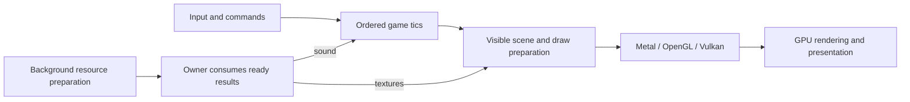

# Engine overview

A short source map for this fork, checked against the source on 2026-11-17.
Start with the [README](../README.md) to run or test a build, and
[CONTRIBUTING](../CONTRIBUTING.md) before changing behavior. The
[roadmap checklist](engine-modernization.md#current-work) tracks pending work;
this guide does not certify a particular build or platform.

## From game data to a frame

At startup the engine loads configuration, its own packages, the player's IWAD
and selected mods. Load order matters when resources and definitions override
earlier ones. The engine initializes its scripting definitions and platform,
audio and rendering systems, then enters the game loop.

The authoritative simulation uses 35 tics per second (`TICRATE` in
[doomdef.h](../src/doomdef.h)). Rendering can run at a different cadence and
interpolate the view. One displayed frame is not necessarily one simulation
tic; loading and catch-up can also occupy a loop iteration.

Conceptually, a normal gameplay frame follows this path. Input polling also
occurs during tic processing; this diagram is not an exact call trace.

The main control flow is [D_DoomLoop](../src/d_main.cpp), which calls
`TryRunTics`, processes events, displays the current state and services music
and deferred work. Tic coordination lives in [d_net.cpp](../src/d_net.cpp);
game actions and save/load orchestration include [g_game.cpp](../src/g_game.cpp).
Actor/thinker and ACS work live under [playsim](../src/playsim).

ZScript compiles and runs through [common/scripting](../src/common/scripting),
with native bindings under [scripting](../src/scripting). Gameplay state, thinker
ordering, callbacks and RNG consumption remain authoritative and ordered. The
sound workers do not make actor ticks or scripts independent jobs. ZScript
`play`/`ui` scopes are language access boundaries, not declarations of separate
operating-system threads.

## Threading in this fork

There is no single threading library or universal pool handling every task.
Engine worker classes and C++ threads are not competing alternatives: the
classes themselves can wrap standard-library threads.

| Work | Mechanism in source | Ownership boundary |
| --- | --- | --- |
| Sound-effect decode preparation | One dedicated `std::thread`, with `std::mutex` and `std::condition_variable` | Owner acquires input, allocates output, opens/closes decoders and publishes OpenAL buffers; worker decodes owned data |
| OpenAL stream service | Separate `std::thread` and stream synchronization | Stream servicing is distinct from cold sound-effect preparation |
| Metal texture/PNG preparation | Grand Central Dispatch queues/groups plus C++ synchronization | Background work uses owned snapshots; this engine consumes results and uploads on its render-owner path |
| Software rendering | Engine `DrawerThreads`/command queues and software-renderer worker objects backed by `std::thread` | Renderer commands and worker completion have their own synchronization |
| Selected image-processing loops | `parallel_for` selects Microsoft PPL, `dispatch_apply`, or an OpenMP-capable/serial loop according to the build | Applies to those call sites, not the whole engine or VM |

Sources: [OpenAL sound implementation](../src/common/audio/sound/oalsound.cpp),
[Metal texture loader](../src/common/rendering/metal/textures/mt_textureloader.cpp),
[drawer workers](../src/common/rendering/r_thread.h),
[software scene workers](../src/rendering/swrenderer/scene/r_scene.cpp), and
[parallel loop wrapper](../src/common/utility/parallel_for.h).

The sound preparation limit is **four admitted jobs, not four decode threads**.
Queued, running and ready jobs share the 64 MiB reservation budget. Sound
preparation currently has a macOS qualification gate. Other platforms retain
the serial fallback. Metal texture preparation uses a concurrent general queue
and a serial PNG queue. These descriptions concern engine-owned work, not an
inventory of every internal driver/library thread.

Main-thread pressure can still come from archive access, decoder setup, misses,
map parsing, world restoration, scene preparation or waits. Background decoding
removes eligible work from that path; it does not eliminate every loading stall.

## Rendering and the render graph

Shared hardware scene preparation lives in
[rendering/hwrenderer](../src/rendering/hwrenderer). Backend implementations
live under [common/rendering](../src/common/rendering). Software rendering has
its own path. The native platform layer supplies windows, events and devices;
ZWidget is part of that integration, not the game simulation or graphics API.

The [frame graph](../src/common/rendering/hwrenderer/frame/hw_framegraph.h)
records resource dependencies, output reachability and transient lifetimes.
Bounded postprocess replay consumes graph order. It is not a whole-engine job
scheduler, does not allocate/alias resources, and does not replace backend
barriers. Dependencies alone do not turn mutable world pointers into safe
worker snapshots. The [graph milestone](engine-modernization.md#current-milestone-frame-graph-coverage-and-bounded-replay)
links the existing backend evidence.

## Maps, mods and documentation

Map acquisition and geometry conversion include [maploader](../src/maploader)
and [p_setup.cpp](../src/p_setup.cpp). UDMF text parsing is in
[udmf.cpp](../src/maploader/udmf.cpp); filesystem/archive support is under
[common/filesystem](../src/common/filesystem). Editing maps, changing runtime
scripts and modifying the C++ engine are distinct workflows.

External references remain useful for language and content-format details:

- [ZDoom wiki](https://zdoom.org/wiki/) and [DoomWiki](https://doomwiki.org/).
  Direct access was blocked during this review, so no complete crawl or
  assessment of their present coverage was performed.
- [ZDoom Docs](https://zdoom-docs.github.io/staging/) provides accessible
  language/API material. The sampled [ZScript introduction](https://zdoom-docs.github.io/staging/ZScript.html)
  and [event-handler reference](https://zdoom-docs.github.io/staging/Api/Events/StaticEventHandler.html)
  are useful references. Its introduction, ACS and object-scoping overview
  pages were marked unfinished during review. That finding is about this
  separate documentation site, not the blocked wiki.

External version labels are not a compatibility guarantee for this fork.
Useful local documentation should explain supported workflows and differences,
link shared references, and include small examples tested with an identified
build. For player adoption, clear launch/mod/save/reporting instructions matter
more than exposing all internal thread classes. The native
[regression guide](../tools/regression/README.md) covers developer controls.
